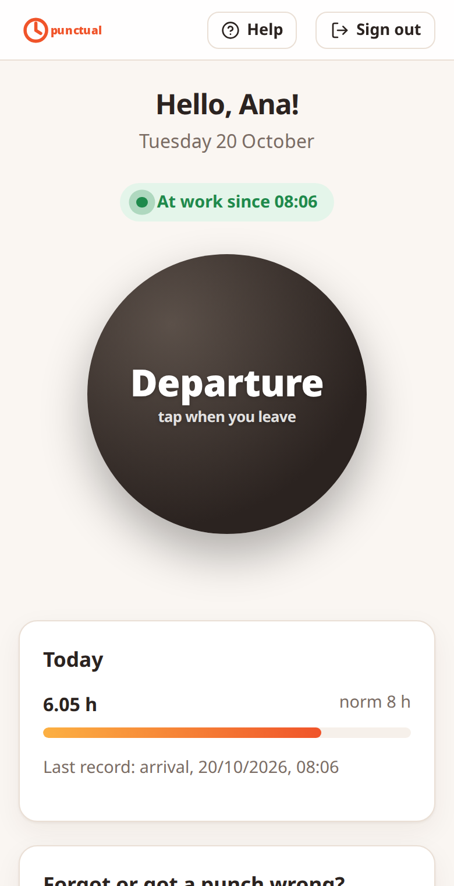
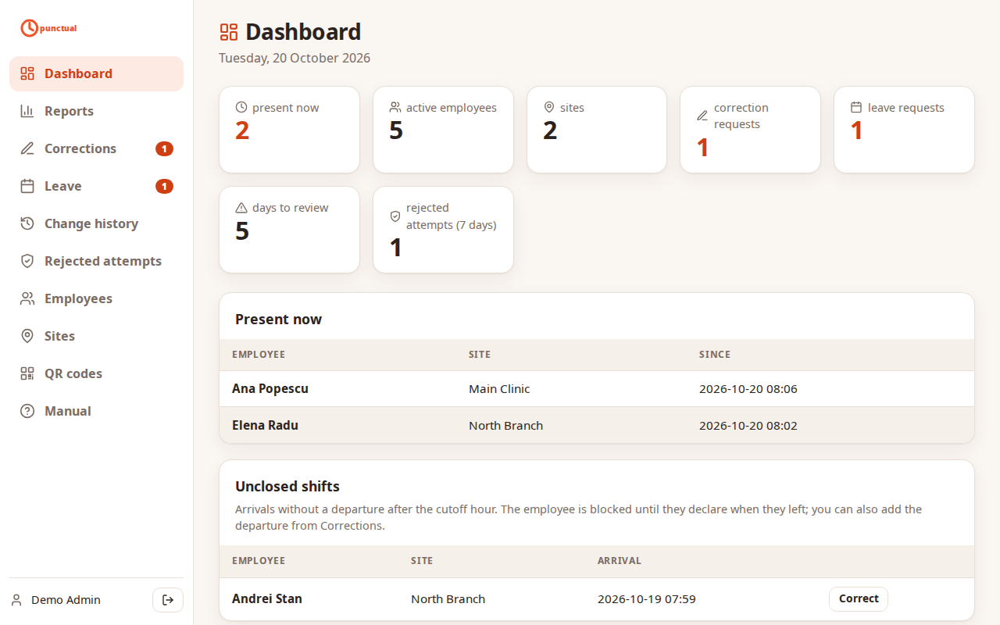
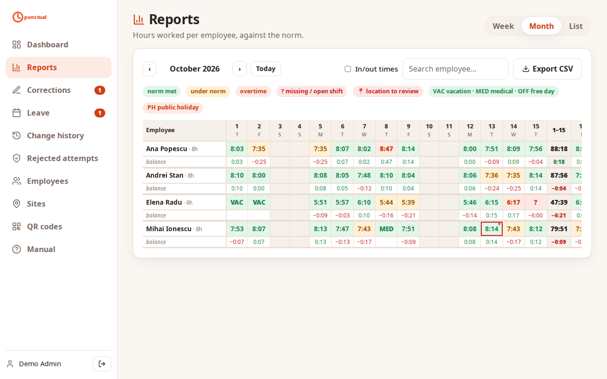
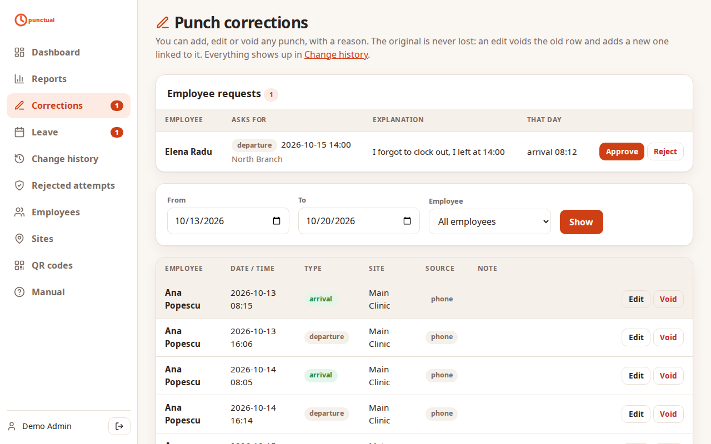

# Punctual

Geofenced employee time clock. Employees scan a QR code at their workplace and clock in or out from their phone; the punch is accepted only near the site (or recorded and flagged for review). Admins correct records, approve leave and export hour reports as CSV. FastAPI + SQLite, with continuous backup through Litestream.

  
  &nbsp;
  

## Features

- **Geofenced punches:** each site has a position, a radius and a QR code to print. A punch far from the site, or with a weak GPS fix, is recorded and flagged for review (or rejected, configurable).
- **Append-only record:** a punch is never edited or deleted. An admin voids it and adds a replacement, and every change is kept in a change history you can export.
- **Requests with approval:** employees ask for missing punches, vacation, medical leave and free days; admins approve or reject with a reason.
- **Reports:** hours per employee against their norm (week, month, list), overtime, anomalies, public holidays, CSV export.
- **Self-service accounts:** one shared registration link; accounts stay inactive until an admin activates them.
- **Backups:** continuous SQLite replication with Litestream, restored automatically on a fresh container.
- **English and Romanian** interface (`PUNCTUAL_LOCALE`); the public holiday calendar is Romania's.

| Reports | Corrections |
|---|---|
|  |  |

## Try it with demo data

    uv sync
    export PUNCTUAL_DB_PATH=/tmp/punctual-demo.db PUNCTUAL_COOKIE_SECURE=false
    uv run punctual-admin seed-demo       # admin@example.com / Demo-Password-1!
    uv run punctual                       # http://localhost:8000

The demo adds four employees, two sites and three weeks of punches, including a flagged location, a forgotten departure, a corrected punch and pending requests. It refuses to run on a database that already has employees. The screenshots above come from it: `uv run python scripts/screenshots.py`.

## Run locally

    uv sync
    PUNCTUAL_COOKIE_SECURE=false uv run punctual      # http://localhost:8000

Create the first admin with `PUNCTUAL_BOOTSTRAP_ADMIN_EMAIL` / `PUNCTUAL_BOOTSTRAP_ADMIN_PASSWORD` (used only while no employees exist), or with `uv run punctual-admin create-admin --name Ana --email ana@example.com` (prompts for the password). All settings are `PUNCTUAL_*` variables, see [`.env.example`](.env.example) and `src/punctual/settings.py`.

## Deploy

Docker Compose on any VPS (HTTPS included) or Google Cloud Run: see [`deploy/README.md`](deploy/README.md).

## Tests

    uv run pytest                 # unit + API scenarios + browser E2E
    uv run pytest tests/e2e       # only the Playwright suite (live server per test, emulated GPS)

E2E uses an installed Chromium (`~/.cache/ms-playwright/chromium-*`, or `E2E_CHROME=/path/to/chrome`); else `uv run playwright install chromium`.
Per-test server settings: `@pytest.mark.server_env(late_in_hour=0, geofence_mode="block")`.

## License

MIT, see [LICENSE](LICENSE).
